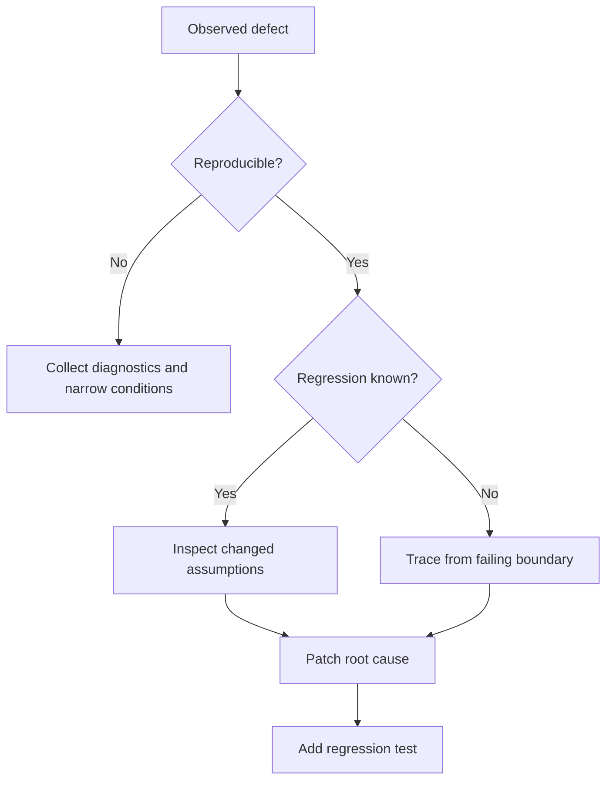

# Frontend Bug Fix Skill

For the Simplified Chinese reference, read `references/zh-CN.md` when the user communicates primarily in Chinese or requests Chinese output.

## Purpose

Reproduce a defect, prove its root cause, implement the smallest safe repair, and prevent regression.

## When to Use

Use for runtime errors, incorrect UI behavior, failed integration, browser differences, performance regressions, or failing tests.

## Inputs

- Expected and actual behavior
- Reproduction steps and environment
- Error output, logs, screenshots, or failing tests
- Relevant recent changes

## Outputs

- Reproduction evidence and root-cause explanation
- Focused patch and regression coverage
- Validation results and residual risk

## Workflow

1. Restate the observable defect and reproduction conditions.
2. Inspect instructions, related code, tests, and recent diffs.
3. Reproduce or create the narrowest failing check.
4. Trace data and control flow to the first incorrect assumption.
5. Separate cause from downstream symptoms.
6. Patch the root cause without unrelated refactoring.
7. Add or update regression coverage.
8. Run focused checks, then broader checks when justified.

## Decision Tree

## Checklist

- [ ] Expected and actual behavior are distinct.
- [ ] Root cause is supported by evidence.
- [ ] Patch scope is minimal.
- [ ] Error, loading, and race conditions are considered.
- [ ] Regression test fails before and passes after the fix when feasible.
- [ ] Unrelated failures are reported, not silently repaired.

## Constraints

- **MUST NOT** guess at the root cause.
- **MUST NOT** weaken types or tests to hide the defect.
- **SHOULD** preserve public behavior outside the reported issue.
- **MUST** request confirmation before destructive data or configuration changes.

## Examples

**Input:** “The save button stays disabled after an API validation error is corrected.”

**Output:** Reproduction, state-transition evidence, a focused reset fix, interaction regression test, and validation summary.

## Anti-patterns

- Adding delays to hide race conditions
- Catching and ignoring the failing exception
- Rewriting a whole module before proving the defect
- Changing expected tests to match broken behavior
