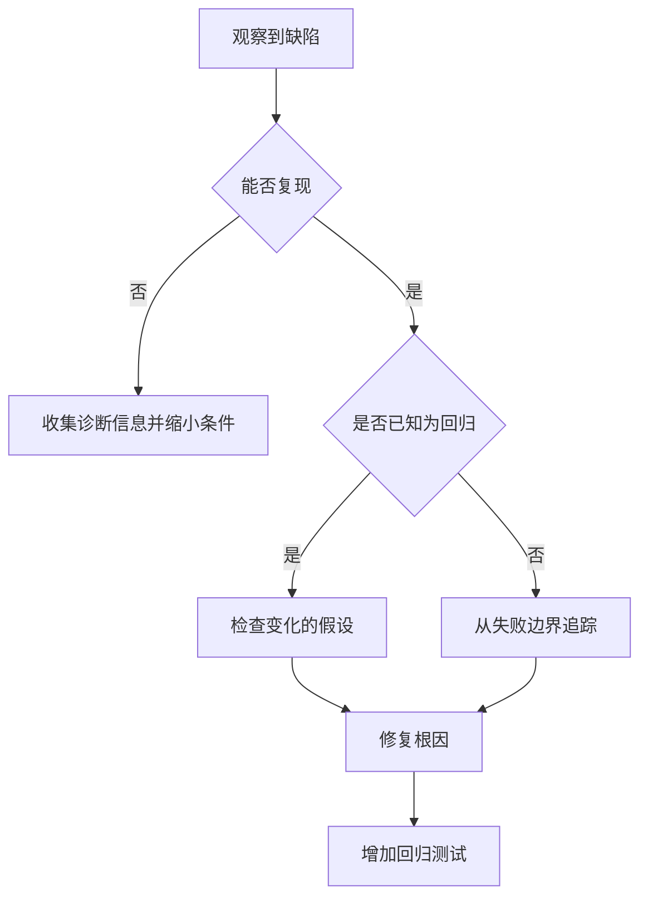

# 前端 Bug 修复 Skill

## 目标

复现缺陷、证明根因、实现最小安全修复并防止回归。

## 使用场景

适用于运行时错误、UI 行为异常、接口联调失败、浏览器差异、性能回归或测试失败。

## 输入

- 预期行为与实际行为
- 复现步骤与环境
- 错误输出、日志、截图或失败测试
- 相关近期变更

## 输出

- 复现证据与根因说明
- 聚焦补丁与回归覆盖
- 验证结果与剩余风险

## 工作流

1. 重述可观察缺陷与复现条件。
2. 检查指令、相关代码、测试与近期 Diff。
3. 复现问题或创建最小失败检查。
4. 沿数据流和控制流追踪第一个错误假设。
5. 区分根因与下游症状。
6. 修复根因，不做无关重构。
7. 新增或更新回归覆盖。
8. 先运行聚焦检查，再按风险运行更广泛检查。

## 决策树

## 检查表

- [ ] 预期与实际行为已明确区分。
- [ ] 根因具有证据支持。
- [ ] 补丁范围最小。
- [ ] 已考虑错误、Loading 与竞态条件。
- [ ] 可行时，回归测试在修复前失败、修复后通过。
- [ ] 无关失败已报告，而非静默修复。

## 约束

- **禁止（MUST NOT）**猜测根因。
- **禁止（MUST NOT）**通过弱化类型或测试隐藏缺陷。
- **应该（SHOULD）**保持问题范围外的公共行为不变。
- 破坏性数据或配置变更前**必须（MUST）**请求确认。

## 示例

**输入：**“API 校验错误修正后，保存按钮仍保持 Disabled。”

**输出：**复现结果、状态转换证据、聚焦的重置修复、交互回归测试与验证总结。

## 反模式

- 增加延迟来掩盖竞态条件
- 捕获并忽略失败异常
- 证明缺陷前重写整个模块
- 修改正确测试以迎合错误行为
