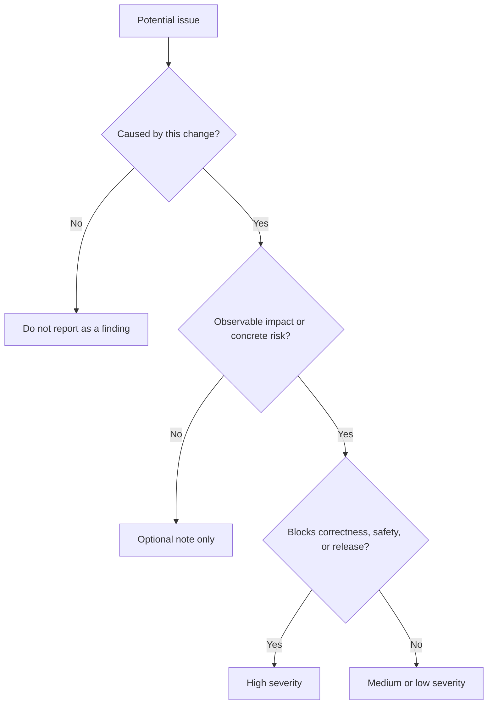

# Frontend Code Review Skill

For the Simplified Chinese reference, read `references/zh-CN.md` when the user communicates primarily in Chinese or requests Chinese output.

## Purpose

Find actionable defects and risks in changed code while separating blocking issues from optional improvements.

## When to Use

Use for pull request review, local diff review, release readiness, or acceptance-criteria verification.

## Inputs

- Diff or changed files
- Requirement and acceptance criteria
- Repository rules and validation output
- Runtime evidence when available

## Outputs

- Findings ordered by severity
- File and line references
- Evidence, impact, and focused remediation
- Validation gaps and residual risk

## Workflow

1. Read the requirement and repository instructions.
2. Inspect the full diff and affected call paths.
3. Verify behavior against acceptance criteria.
4. Check types, architecture, state, errors, accessibility, performance, security, naming, and tests.
5. Reproduce high-risk findings where practical.
6. Report only actionable findings with evidence.
7. Summarize validation gaps after findings.

## Decision Tree

## Checklist

- [ ] Findings are caused by the reviewed change.
- [ ] Severity matches impact and likelihood.
- [ ] Each finding includes a precise location.
- [ ] Suggested remediation is smaller than a rewrite.
- [ ] Missing tests are tied to concrete risk.
- [ ] Summary does not hide important findings.

## Constraints

- **MUST** lead with findings, ordered by severity.
- **MUST NOT** report style preference as a defect when conventions are met.
- **MUST NOT** claim a bug without a plausible failing scenario.
- **SHOULD** distinguish verified facts from uncertainty.

## Examples

**Finding:** “High — `src/cart/save.ts:42` retries a non-idempotent purchase request after timeout, which can create duplicate orders. Add an idempotency key or disable automatic retry.”

## Anti-patterns

- Summarizing the diff without reviewing it
- Producing many low-value style comments
- Missing security or accessibility regressions
- Giving vague feedback without location or impact
