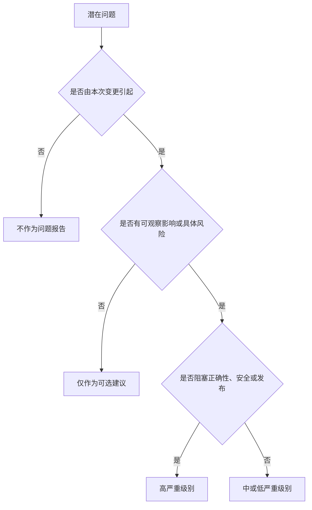

# 前端 Code Review Skill

## 目标

发现变更代码中的可执行缺陷与风险，并区分阻塞问题和可选改进。

## 使用场景

适用于 Pull Request 评审、本地 Diff 评审、发布准备或验收标准核对。

## 输入

- Diff 或已修改文件
- 需求与验收标准
- 仓库规则与验证输出
- 可用的运行时证据

## 输出

- 按严重级别排序的问题
- 文件与行号引用
- 证据、影响与聚焦修复建议
- 验证缺口与剩余风险

## 工作流

1. 阅读需求与仓库指令。
2. 检查完整 Diff 与受影响调用路径。
3. 根据验收标准验证行为。
4. 检查类型、架构、状态、错误、可访问性、性能、安全、命名与测试。
5. 可行时复现高风险问题。
6. 只报告具有证据且可执行的问题。
7. 在问题列表后总结验证缺口。

## 决策树

## 检查表

- [ ] 问题由被评审变更引起。
- [ ] 严重级别符合影响与发生概率。
- [ ] 每个问题包含精确位置。
- [ ] 修复建议比重写更聚焦。
- [ ] 缺失测试与具体风险相关。
- [ ] 总结不会掩盖重要问题。

## 约束

- **必须（MUST）**先列问题，并按严重级别排序。
- 已符合仓库约定时，**禁止（MUST NOT）**将风格偏好报告为缺陷。
- 没有合理失败场景时，**禁止（MUST NOT）**声称存在 Bug。
- **应该（SHOULD）**区分已验证事实与不确定判断。

## 示例

**问题：**“High — `src/cart/save.ts:42` 在超时后重试非幂等购买请求，可能创建重复订单。请增加 Idempotency Key 或禁用自动重试。”

## 反模式

- 只总结 Diff 而不进行评审
- 输出大量低价值风格评论
- 忽略安全或可访问性回归
- 反馈模糊且没有位置或影响
