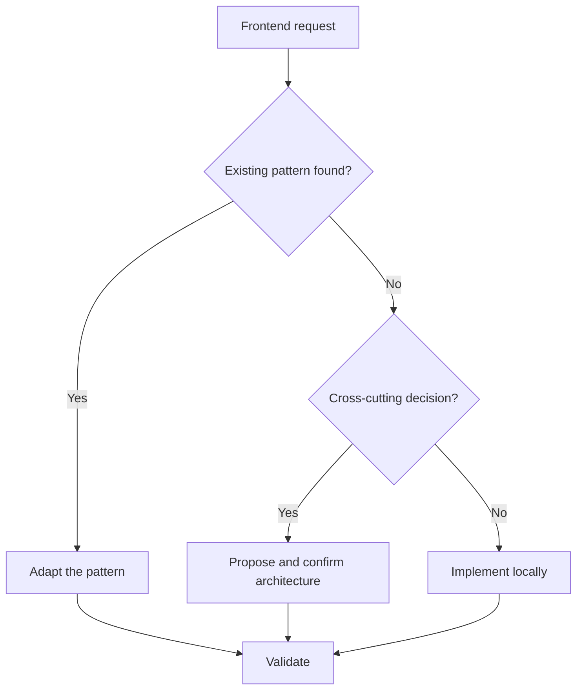

# Frontend Engineering Skill

For the Simplified Chinese reference, read `references/zh-CN.md` when the user communicates primarily in Chinese or requests Chinese output.

## Purpose

Deliver maintainable frontend changes that fit the existing architecture and satisfy functional and non-functional requirements.

## When to Use

Use for new screens, workflows, integrations, cross-component behavior, or changes spanning multiple frontend concerns.

## Inputs

- Requirement and acceptance criteria
- Repository path and applicable agent instructions
- Design, API contract, screenshots, or issue context
- Required validation commands

## Outputs

- Evidence-based implementation plan
- Focused code and documentation changes
- Validation results, risks, and known limitations

## Workflow

1. Read repository instructions and inspect the project structure.
2. Search for similar features, components, API patterns, and tests.
3. Restate scope, acceptance criteria, assumptions, and exclusions.
4. Map architecture, data flow, states, accessibility, and failure behavior.
5. Request confirmation when the change is destructive, ambiguous, or materially expands scope.
6. Implement the smallest coherent vertical slice.
7. Validate types, lint, tests, build, accessibility, and performance as applicable.
8. Summarize changed behavior and remaining risks.

## Decision Tree

## Checklist

- [ ] Acceptance criteria are testable.
- [ ] Loading, empty, error, and success states exist.
- [ ] Data is typed and validated.
- [ ] Keyboard and screen-reader behavior is covered.
- [ ] Performance and security impacts are assessed.
- [ ] Relevant quality gates pass.

## Constraints

- **MUST** follow existing repository conventions.
- **MUST NOT** invent commands, APIs, or design tokens.
- **SHOULD** reuse stable local abstractions.
- **SHOULD NOT** add a dependency without documented value and impact.

## Examples

**Input:** “Add a paginated customer search page using the existing API client.”

**Output:** A plan based on discovered list patterns, typed API mapping, complete UI states, focused implementation, tests, and validation summary.

## Anti-patterns

- Editing before inspecting repository instructions
- Building only the happy path
- Duplicating server data into global state without need
- Declaring success without running available checks
