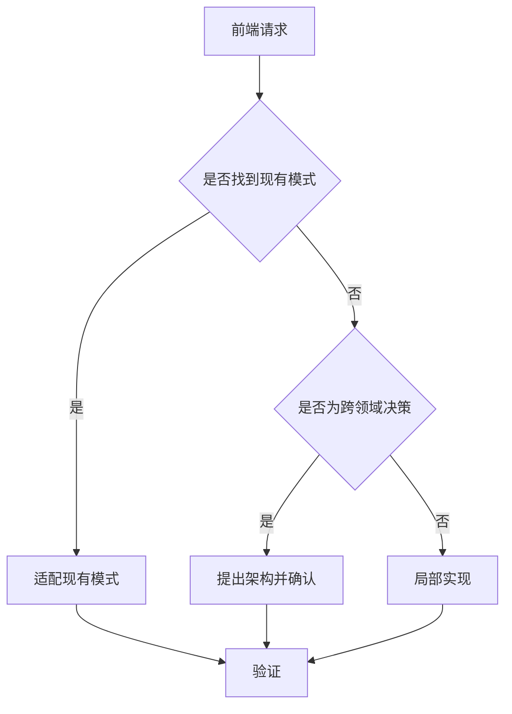

# 前端工程 Skill

## 目标

交付符合现有架构、满足功能与非功能需求且易于维护的前端变更。

## 使用场景

适用于新增页面、业务流程、接口集成、跨组件行为或涉及多个前端关注点的变更。

## 输入

- 需求与验收标准
- 仓库路径与适用的 Agent 指令
- 设计稿、接口契约、截图或 Issue 上下文
- 必需验证命令

## 输出

- 基于证据的实现计划
- 聚焦的代码与文档变更
- 验证结果、风险与已知限制

## 工作流

1. 阅读仓库指令并检查项目结构。
2. 搜索类似功能、组件、API 模式与测试。
3. 重述范围、验收标准、假设与不包含项。
4. 梳理架构、数据流、状态、可访问性与失败行为。
5. 变更具有破坏性、存在歧义或明显扩大范围时请求确认。
6. 实现最小的内聚垂直切片。
7. 按适用范围验证类型、Lint、测试、构建、可访问性与性能。
8. 总结行为变化与剩余风险。

## 决策树

## 检查表

- [ ] 验收标准可测试。
- [ ] 已覆盖 Loading、Empty、Error 与 Success 状态。
- [ ] 数据已类型化并验证。
- [ ] 已覆盖键盘与屏幕阅读器行为。
- [ ] 已评估性能与安全影响。
- [ ] 相关质量门禁通过。

## 约束

- **必须（MUST）**遵循仓库现有约定。
- **禁止（MUST NOT）**虚构命令、API 或 Design Token。
- **应该（SHOULD）**复用稳定的本地抽象。
- 未记录价值与影响时，**不应该（SHOULD NOT）**新增依赖。

## 示例

**输入：**“使用现有 API Client 新增分页客户搜索页面。”

**输出：**基于现有列表模式的计划、类型化 API 映射、完整 UI 状态、聚焦实现、测试与验证总结。

## 反模式

- 未检查仓库指令就开始编辑
- 只实现 Happy Path
- 无必要地将服务端数据复制到全局状态
- 未运行可用检查就宣布完成
