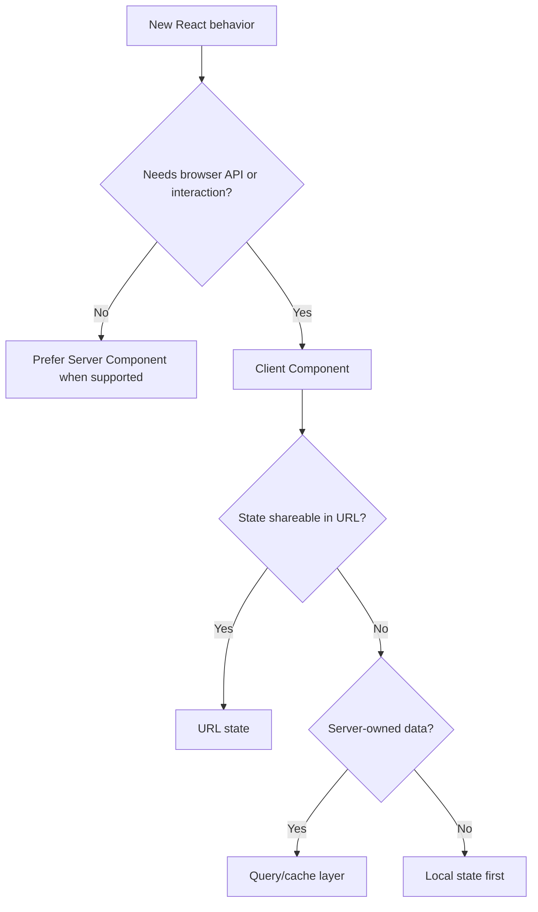

# React Engineering Skill

For the Simplified Chinese reference, read `references/zh-CN.md` when the user communicates primarily in Chinese or requests Chinese output.

## Purpose

Produce predictable React behavior with explicit ownership, stable rendering boundaries, and accessible component APIs.

## When to Use

Use for React components, hooks, Context, forms, data fetching, Server/Client Component boundaries, or render performance.

## Inputs

- Component behavior and states
- React/framework version and rendering model
- Existing component, hook, state, and test patterns
- Design and API contracts

## Outputs

- Component boundary and ownership plan
- Typed React implementation
- Interaction tests and performance notes

## Workflow

1. Identify framework version, router, rendering mode, and style system.
2. Search for equivalent components and hooks.
3. Decide server, client, local state, URL state, and cache ownership.
4. Design typed props, events, composition points, and error states.
5. Implement without effects for values that can be derived during render.
6. Add behavior-focused tests and inspect avoidable rerenders.
7. Validate hydration, keyboard behavior, and reduced motion where relevant.

## Decision Tree

## Checklist

- [ ] Hooks obey call-order rules.
- [ ] State has a single owner.
- [ ] Effects synchronize only with external systems.
- [ ] Keys are stable and semantic.
- [ ] Server/Client boundaries minimize JavaScript.
- [ ] Tests use roles, names, and user interactions.

## Constraints

- **MUST** use function components unless the repository requires otherwise.
- **MUST NOT** mutate props or state.
- **SHOULD NOT** use `useMemo`, `useCallback`, or `memo` without measured value.
- **MUST NOT** suppress Hydration errors instead of fixing their cause.

## Examples

**Good:** derive `filteredItems` during render from `items` and `query`.

**Bad:** store `filteredItems` in state and synchronize it in an effect.

## Anti-patterns

- Giant components combining data, business rules, and presentation
- Context used for rapidly changing local state
- Index keys for reorderable lists
- Client Components added only to access static utilities
