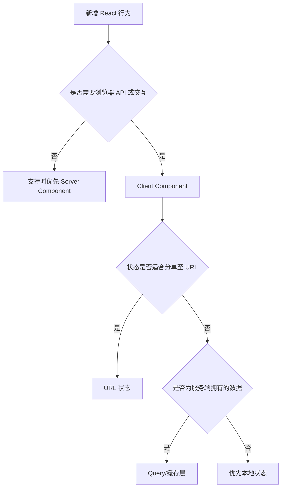

# React 工程 Skill

## 目标

通过明确的所有权、稳定渲染边界与可访问组件 API，交付可预测的 React 行为。

## 使用场景

适用于 React 组件、Hook、Context、表单、数据请求、Server/Client Component 边界或渲染性能。

## 输入

- 组件行为与状态
- React/框架版本与渲染模型
- 现有组件、Hook、状态与测试模式
- 设计与 API 契约

## 输出

- 组件边界与所有权计划
- 类型化 React 实现
- 交互测试与性能说明

## 工作流

1. 识别框架版本、路由、渲染模式与样式系统。
2. 搜索等价组件与 Hook。
3. 确定服务端、客户端、本地状态、URL 状态与缓存所有权。
4. 设计类型化 Props、事件、组合点与错误状态。
5. 可在 Render 阶段派生的值不得使用 Effect 同步。
6. 增加面向行为的测试并检查可避免的重复渲染。
7. 按适用范围验证 Hydration、键盘行为与减少动效设置。

## 决策树

## 检查表

- [ ] Hook 遵循调用顺序规则。
- [ ] 状态具有唯一所有者。
- [ ] Effect 只同步外部系统。
- [ ] Key 稳定且有业务语义。
- [ ] Server/Client 边界减少客户端 JavaScript。
- [ ] 测试使用 Role、Name 与用户交互。

## 约束

- 除非仓库另有要求，**必须（MUST）**使用函数组件。
- **禁止（MUST NOT）**修改 Props 或 State。
- 未证明价值时，**不应该（SHOULD NOT）**使用 `useMemo`、`useCallback` 或 `memo`。
- **禁止（MUST NOT）**通过忽略 Hydration 错误代替根因修复。

## 示例

**Good：**在 Render 阶段根据 `items` 与 `query` 派生 `filteredItems`。

**Bad：**将 `filteredItems` 存入 State 并通过 Effect 同步。

## 反模式

- 一个巨型组件同时承担数据、业务规则与展示
- 用 Context 保存快速变化的局部状态
- 可重排列表使用数组下标 Key
- 仅为访问静态工具而增加 Client Component
